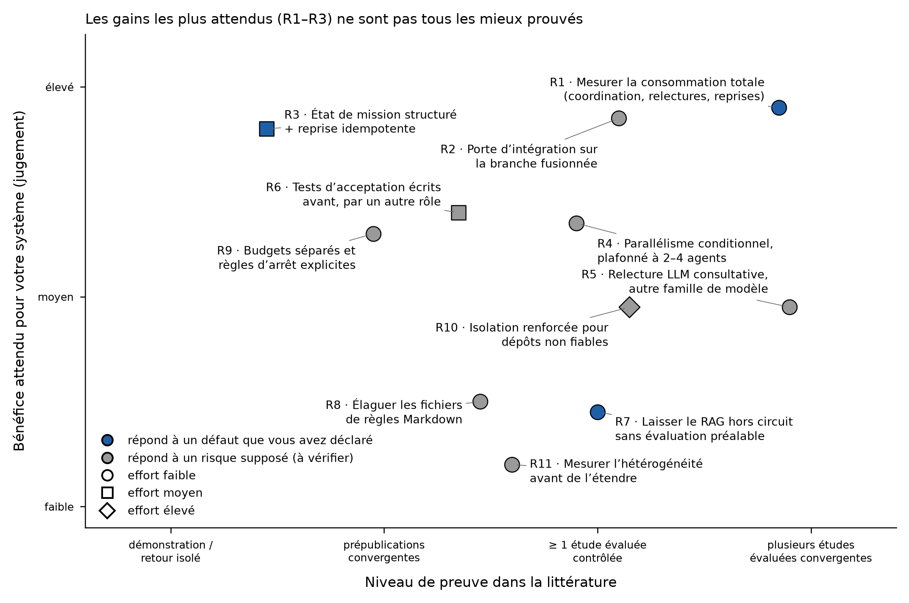

# Revue critique : améliorer un système multi-agents de développement logiciel

*Analyse indépendante, état de la littérature au 17 octobre 2026. Les étiquettes **[Résultat]**, **[Entreprise]**, **[Déduction]** et **[Hypothèse]** séparent les résultats scientifiques, les retours d'expérience d'entreprises, les recommandations déduites des sources et les hypothèses à tester sur votre système. Votre code n'a pas été examiné : les risques signalés sont des risques d'architecture, aucun bug d'implémentation n'est affirmé.*

## A. Verdict

Votre architecture est **cohérente avec les preuves disponibles sur ses choix structurants**. Elle a aussi **trois écarts** par rapport à ce que la littérature soutient.

Ce qui est bien étayé et déjà présent :

- **[Résultat]** Une coordination centralisée, avec un point de validation, contient mieux la propagation d'erreurs que des agents indépendants : au niveau des traces, un facteur 4,4 contre 17,2 [Kim et al. 2025](https://arxiv.org/abs/2512.08296) (prépublication). La structure hiérarchique est la plus résiliente quand des agents se trompent [Huang et al. 2024](https://arxiv.org/abs/2408.00989).
- **[Résultat]** L'isolation par worktree Git est indispensable dès qu'il y a parallélisme. Dans l'étude CAID [Geng et al. 2026](https://arxiv.org/abs/2603.21489), des agents partageant un même espace de travail font *moins bien* qu'un agent seul : 55,5 contre 57,2 sur PaperBench. Avec des worktrees, ils atteignent 63,3.
- **[Résultat]** Des contrôles exécutables et déterministes (tests, types, lint) sont plus fiables qu'un jugement par LLM [Jiang et al. 2026](https://doi.org/10.18653/v1/2026.acl-long.888) [Panickssery et al. 2024](https://doi.org/10.52202/079017-2197). Un pipeline fixe peut rivaliser avec des agents autonomes [Xia et al. 2025](https://doi.org/10.1145/3715754).
- **[Résultat]** Les fiches de tâche (objectif, périmètre, vérifications) répondent à la première cause d'échec recensée, les défauts de spécification et de conception [Cemri et al. 2025](https://doi.org/10.52202/085713-4082).

Les trois écarts :

1. **Le parallélisme n'est utile que sous conditions.** **[Résultat]** Sur des tâches de type correction d'issue avec des modèles récents, aucune architecture multi-agents ne dépasse l'agent seul. Sur SWE-bench Verified, l'agent seul obtient 0,522, l'architecture centralisée −3,1 %, l'architecture indépendante −14,9 % [Kim et al. 2025](https://arxiv.org/abs/2512.08296), mais l'échantillon ne compte que 20 instances. Même dans CAID, qui est le cas favorable, le gain avec Claude Sonnet 4.5 est de +6,1 points pour un coût API environ doublé, sans réduction de la durée. **[Déduction]** Le parallélisme doit être une exception déclenchée par un critère explicite, pas le mode par défaut.
2. **Vos défauts déclarés sont justement ceux qui empêchent de juger le reste.** Consommation partiellement inconnue, reprise de mission incomplète, progression tenue en Markdown : sans comptabilité complète ni état fiable, ni vous ni moi ne pouvons dire si le système améliore la qualité à un coût acceptable.
3. **La vérification du résultat combiné et la place des relectures LLM restent à préciser.** **[Résultat]** Les tests d'un patch isolé laissent passer des patchs incorrects : 7,8 % de faux succès et 29,6 % de comportements divergents de la référence [Wang et al. 2026](https://doi.org/10.1145/3744916.3764576). Les relecteurs LLM sont biaisés et instables [Panickssery et al. 2024](https://doi.org/10.52202/079017-2197) [Jiang et al. 2026](https://doi.org/10.18653/v1/2026.acl-long.888) [Jin et al. 2025](https://doi.org/10.1109/ase63991.2025.00323).

**[Résultat]** Votre impression d'un gain de qualité n'est pas validée, et la seule étude randomisée de terrain incite à la prudence. Dans l'essai de [Becker et al. 2025](https://arxiv.org/abs/2507.09089) (prépublication, 16 développeurs, 246 tâches), les participants estimaient après coup avoir gagné 20 % de temps, alors que la mesure montrait 19 % de temps *en plus*. Cela ne prouve pas que votre impression est fausse : outils de début 2025, contexte différent. Cela montre seulement que l'impression ne suffit pas.

Votre décision de **ne pas raccorder le RAG** est cohérente avec les preuves (section Q5).

## Stratégie de recherche

**Sources consultées.** OpenAlex avec votre clé : 55 requêtes thématiques couvrant les 8 questions (publications depuis juin 2022), 72 recherches par titre pour les travaux fondateurs et les résultats négatifs connus, et les articles citant 9 articles pivots. Pages arXiv : versions et commentaires d'acceptation. API OpenReview : décisions ICLR, ICML, NeurIPS, COLM, TMLR. Crossref : 27 DOI d'éditeur, recherche de rétractations. Trois recherches web. Documentation officielle de Docker. Billet de Cognition.

**Volume et sélection.** 1 535 notices collectées, 93 retenues, 32 protocoles détaillés dans [etudes_protocoles.csv](etudes_protocoles.csv), texte intégral lu pour 10 études. Critères d'inclusion : agents LLM appliqués au génie logiciel, ou mécanisme transférable (coordination, vérification, mémoire, reprise, isolation, coût). Priorité aux comparaisons contrôlées et aux résultats négatifs. Exclusion des dépôts sans évaluation (par exemple Zenodo) et des systèmes sans comparateur, sauf s'ils sont très proches de votre architecture (ESAA).

**Statut des 93 références.** 40 actes de conférence évalués par les pairs, 11 articles de revue, 1 piste courte, 5 ateliers, 36 prépublications ([biblio_verifiee.csv](biblio_verifiee.csv)). Aucune rétractation trouvée.

**Vérifications qui ont changé une conclusion :**

- **Version.** [Kim et al. 2025](https://arxiv.org/abs/2512.08296) est passé de 180 configurations et un R² de 0,513 (v1) à 260 configurations et un R² de 0,373 (v3). Je cite la v3.
- **Résumé trompeur.** Le « +25,6 points » mis en avant par CAID vient d'un modèle faible (MiniMax : 10,5 → 36,1). Il ne s'applique pas aux modèles que vous utilisez.
- **Erreur de base de données.** OpenAlex attachait à SWE-Bench Pro le DOI et le résumé d'un autre article. Corrigé d'après arXiv.
- **Statut.** SWE-Bench+ et Large Language Monkeys ont été rejetés à ICLR 2025. Ils restent des prépublications.

**Lacunes de la recherche :**

- L'API arXiv refusait les requêtes (limite de débit) et DBLP imposait une vérification anti-robot ; le repérage a reposé sur OpenAlex.
- Les billets d'ingénierie d'Anthropic ont été refusés par le serveur (403). Ils n'ont pas été utilisés.
- Le graphe des citations d'OpenAlex est pauvre pour les prépublications de 2026.
- **Aucune étude contrôlée** ne porte sur la reprise après quota fournisseur, la réutilisation de volumes de dépendances, ou un poste de 24 Go exécutant plusieurs conteneurs.
- Presque toutes les mesures portent sur des benchmarks Python publics, possiblement mémorisés par les modèles [Liang et al. 2026](https://doi.org/10.1145/3786583.3786882).

## Synthèse par question

### Q1 : Un agent ou plusieurs

**[Résultat]** Quand la tâche est séquentielle et que l'agent seul réussit déjà bien, ajouter des agents n'aide pas et peut nuire. [Kim et al. 2025](https://arxiv.org/abs/2512.08296) relève un effet de saturation : au-delà d'environ 45 % de réussite de l'agent seul, la coordination rapporte peu ou devient négative. L'effet va de +80,8 % sur des tâches financières décomposables à −70 % sur de la planification séquentielle. Avec un seul modèle (GPT-4.1) et 3 302 instances, un seul workflow multi-agents sur six dépasse l'agent seul, et le débat consomme 1,39 fois plus de tokens pour un résultat moyen inférieur [Fu et al. 2026](https://arxiv.org/abs/2606.05670) (prépublication). Hors génie logiciel, un agent seul bien prompté égale la meilleure discussion multi-agents [Wang et al. 2024](https://doi.org/10.18653/v1/2024.acl-long.331), et le débat ne bat pas de façon fiable l'auto-cohérence [Smit et al. 2023](https://arxiv.org/abs/2311.17371).

**[Résultat, contradictoire]** Le parallélisme aide sur des travaux longs composés de parties indépendantes. CAID améliore l'implémentation de bibliothèques Python (Commit0-Lite : 53,1 → 59,1) et la reproduction d'articles [Geng et al. 2026](https://arxiv.org/abs/2603.21489). Le nombre optimal d'agents y est faible : passer de 2 à 4 améliore, passer à 8 dégrade.

**[Entreprise]** Cognition ([Yan, 12 juin 2025](https://cognition.ai/blog/dont-build-multi-agents)) défend des agents à fil unique. Son argument : chaque action contient des décisions implicites, et des sous-agents parallèles prennent des décisions incompatibles. Ce billet est un argumentaire, sans mesure.

**[Déduction]** Une tâche mérite d'être parallélisée si trois conditions sont réunies : (a) elle se découpe en composants qui touchent des fichiers distincts et ont leurs propres tests ; (b) les interfaces entre composants peuvent être fixées *avant* de déléguer ; (c) la fusion est mécanique. Les sous-tâches en lecture seule (exploration, recherche, diagnostic) se parallélisent sans risque de conflit d'écriture. **[Hypothèse]** La proportion de vos tâches qui remplissent ces conditions est inconnue : le protocole E la mesure.

### Q2 : Organisation et rôles

**[Résultat]** L'organisation la mieux soutenue est un coordinateur central avec un goulot de validation [Kim et al. 2025](https://arxiv.org/abs/2512.08296) [Huang et al. 2024](https://arxiv.org/abs/2408.00989) [Geng et al. 2026](https://arxiv.org/abs/2603.21489). La coordination décentralisée n'a l'avantage que sur des tâches de navigation web dynamique, selon la v1 de [Kim et al. 2025](https://arxiv.org/abs/2512.08296). Les démonstrations par rôles humains ([Hong et al. 2023](https://arxiv.org/abs/2308.00352), [Qian et al. 2024](https://doi.org/10.18653/v1/2024.acl-long.810)) se comparaient à d'autres systèmes multi-agents de 2023, pas à un agent seul moderne. Les ablations de harnais montrent que des sous-agents *spécialisés* apportent les gains les plus stables, tandis que des sous-agents *généralistes* et la compression de contexte peuvent nuire [Hu et al. 2026](https://arxiv.org/abs/2609.32459) (prépublication). Deux rôles distincts ont un soutien expérimental : un **concepteur de tests séparé du programmeur** [Huang et al. 2023](https://arxiv.org/abs/2312.13010) (prépublication) et un **inspecteur** qui relit les messages [Huang et al. 2024](https://arxiv.org/abs/2408.00989).

**[Résultat]** Ce qui peut être déterministe gagne à l'être. [Xia et al. 2025](https://doi.org/10.1145/3715754) remplace les décisions de l'agent par un pipeline fixe sans perdre en performance. Trois harnais ouverts ont convergé vers un journal de session en ajout seul, rejouable [Dai et al. 2026](https://arxiv.org/abs/2608.23953) (prépublication). L'attribution automatique des échecs par un LLM reste peu fiable : 14,2 % de réussite pour retrouver l'étape fautive [Zhang et al. 2025](https://arxiv.org/abs/2505.00212).

**[Déduction]** Restent à un LLM : l'interprétation de la demande, la décomposition, la rédaction des fiches, les réponses aux questions et l'implémentation. Passent dans du code déterministe : ordonnancement, verrous et baux, fusions, portes de vérification, budgets, compteurs, règles d'arrêt, état de mission et reprise.

### Q3 : Tâches, dépendances, messages, arrêt

**[Résultat]** Les échecs viennent d'abord de la spécification, du désalignement entre agents et d'une vérification défaillante [Cemri et al. 2025](https://doi.org/10.52202/085713-4082). Une instruction fragmentée sur plusieurs tours fait chuter la performance de 39 % en moyenne, car les modèles supposent trop tôt et ne se rattrapent pas [Laban et al. 2025](https://arxiv.org/abs/2505.06120). Face à une demande ambiguë, plus de 60 % des réponses génèrent du code au lieu de poser une question [Wu et al. 2025](https://doi.org/10.1145/3715109), et savoir coder n'implique pas savoir clarifier [Fang et al. 2026](https://arxiv.org/abs/2607.00711) (prépublication). Les trajectoires en échec sont plus longues et plus variables que celles qui réussissent [Majgaonkar et al. 2025](https://arxiv.org/abs/2511.00197) (prépublication).

**[Déduction]** Une fiche de tâche devrait être complète dès la première remise et contenir :

- l'objectif ;
- le périmètre en écriture et en lecture ;
- les décisions partagées (signatures, schémas, noms) ;
- les tests d'acceptation ;
- les dépendances (identifiants de tâches) ;
- un budget en tours, en tokens et en durée ;
- une condition d'escalade.

Règles d'arrêt suggérées : (1) arrêt quand le budget de la tâche est atteint ; (2) arrêt après deux échecs consécutifs de la même vérification avec le même diagnostic ; (3) arrêt quand rien n'avance (diff inchangé) pendant N tours ; (4) question obligatoire via le courtier si une ambiguïté listée dans la fiche se présente. Les valeurs de N et des budgets sont à calibrer sur vos journaux, aucune étude ne les fixe.

### Q4 : Vérification

**[Résultat]** Les tests d'un patch isolé sont un filtre nécessaire mais insuffisant. Sur SWE-bench Verified, 7,8 % des patchs comptés corrects échouent à la suite complète des développeurs, et 29,6 % des patchs plausibles se comportent autrement que la référence [Wang et al. 2026](https://doi.org/10.1145/3744916.3764576). 10,7 % des succès reposent sur un processus défectueux : boucles de régression, essais à l'aveugle, vérification absente [Sahoo et al. 2026](https://arxiv.org/abs/2605.12925) (atelier). Sans retour externe, l'auto-correction n'aide pas [Huang et al. 2023](https://arxiv.org/abs/2310.01798). L'auto-réparation dépend de la qualité du retour [Olausson et al. 2023](https://arxiv.org/abs/2306.09896).

**[Résultat : limites des évaluateurs LLM]** Un juge LLM favorise ses propres productions [Panickssery et al. 2024](https://doi.org/10.52202/079017-2197). Tous les juges de code testés sont sensibles à l'ordre des réponses, aux noms de variables et aux commentaires trompeurs [Jiang et al. 2026](https://doi.org/10.18653/v1/2026.acl-long.888). Les LLM jugent souvent non conforme du code correct, et des prompts plus élaborés (explication puis correction) *augmentent* ces erreurs [Jin et al. 2025](https://doi.org/10.1109/ase63991.2025.00323) [Jin et al. 2026](https://doi.org/10.1007/s10515-026-00638-5). **[Entreprise]** Chez Beko, l'évaluation automatique des commentaires d'un bot de relecture ne s'accorde que modérément avec les développeurs (0,44–0,62) [Karakaya et al. 2026](https://arxiv.org/abs/2604.24525). Dans une autre entreprise, 73,8 % des commentaires automatiques ont été traités, mais le temps de clôture des PR est passé de 5 h 52 à 8 h 20 [Cihan et al. 2025](https://doi.org/10.1109/icse-seip66354.2025.00043). **[Résultat, nuance]** Un évaluateur *agentique* qui inspecte le processus s'approche du jugement humain sur 55 tâches [Zhuge et al. 2024](https://arxiv.org/abs/2410.10934), mais sur un benchmark créé par les mêmes auteurs.

**[Déduction]** La seule porte de fusion devrait être exécutable :

1. tests d'acceptation écrits avant l'implémentation, et non modifiables par l'implémenteur ;
2. suite complète, types, lint et contrôle du périmètre (diff limité aux fichiers réservés) ;
3. après fusion, la même batterie relancée **sur la branche principale fusionnée**, dans un conteneur neuf, avec une vérification de non-régression (les tests qui passaient avant doivent passer après).

La relecture LLM reste consultative : modèle d'une autre famille que l'auteur, liste de contrôle tirée de la fiche, constats renvoyés à l'orchestrateur ou à vous, jamais un verdict bloquant à lui seul. **[Hypothèse]** Une relecture croisée entre familles (Claude relu par Codex, et inversement) réduirait l'auto-préférence. C'est une déduction à partir de [Panickssery et al. 2024](https://doi.org/10.52202/079017-2197), non testée en génie logiciel.

### Q5 : Mémoire

**[Résultat]** Plus de texte persistant n'améliore pas les résultats. Les fichiers de contexte de type AGENTS.md n'améliorent pas le taux de réussite en général et augmentent le coût d'inférence de plus de 20 % [Gloaguen et al. 2026](https://arxiv.org/abs/2602.11988) (ateliers). Avec Claude Code et Codex, l'effet de la stratégie de contexte est trop faible pour être mesuré : borné à 10–15 points par test d'équivalence. Les échecs viennent de l'implémentation, pas d'un manque d'information [Khatri 2026](https://arxiv.org/abs/2607.27250) (prépublication, 288 exécutions). Ces fichiers évoluent comme du code de configuration [Chatlatanagulchai et al. 2026](https://doi.org/10.1145/3840295). 62 % contiennent des règles qui relèvent du lint et 42 % sont surchargés [Santos et al. 2026](https://arxiv.org/abs/2606.15828). Les modèles exploitent mal l'information placée au milieu d'un long contexte [Liu et al. 2024](https://doi.org/10.1162/tacl_a_00638), et leur taille de contexte utile est inférieure à la taille annoncée [Hsieh et al. 2024](https://arxiv.org/abs/2404.06654). Ils peuvent répondre avec une valeur périmée encore présente dans le contexte [Guo et al. 2026](https://arxiv.org/abs/2609.38866) (prépublication) : c'est un risque direct pour des notes de progression qui s'accumulent.

**[Résultat : solutions simples]** Masquer les anciennes observations est aussi efficace qu'un résumé par LLM et coûte environ deux fois moins [Lindenbauer et al. 2025](https://arxiv.org/abs/2508.21433) (atelier). Moins de tokens ne veut pas toujours dire moins cher ni plus rapide [Satish et al. 2026](https://arxiv.org/abs/2609.32961). Le contexte long bat le RAG quand les ressources suffisent, le RAG reste moins cher [Li et al. 2024](https://doi.org/10.18653/v1/2024.emnlp-industry.66). **Lacune** : aucune étude trouvée ne compare RAG et recherche textuelle (ripgrep, index de symboles) pour un agent de code travaillant sur un dépôt privé.

**[Déduction]** Séparer quatre choses :

1. **l'état courant** (ce qui est vrai maintenant : tâches, statuts, baux, budgets), en données structurées — c'est la source de vérité ;
2. **les décisions**, en Markdown court, datées, avec un statut (actif / remplacé par) et une source (tâche, commit) ;
3. **les règles**, limitées aux conventions non standard, sans répéter ce que le lint vérifie déjà ;
4. **l'historique**, dans le journal d'événements, consultable par recherche textuelle.

À la reprise, le point de départ est *régénéré* depuis l'état et le journal, et non tiré d'un résumé de conversation.

### Q6 : Reprise fiable

**Trois ressources différentes**, chacune avec son compteur, son déclencheur et sa réponse :

| Ressource | Nature | Signal | Réponse |
|---|---|---|---|
| Fenêtre de contexte | limite *par session d'agent* | taille du contexte proche du seuil | masquer d'anciennes observations ou relancer une session neuve à partir de la fiche et de l'état |
| Quota fournisseur | limite *externe, sur une fenêtre de temps* | erreurs de limite d'usage, heure de réinitialisation | suspendre la tâche (bail rendu), reprendre plus tard ou chez un autre fournisseur |
| Budget de mission | limite *que vous fixez*, cumulée sur tous les appels (orchestration, relectures, reprises) | registre de consommation | s'arrêter et vous demander arbitrage |

**[Résultat]** La littérature scientifique sur ce point est mince. [Wu et al. 2026](https://arxiv.org/abs/2604.28138) (prépublication) montre qu'une reprise fondée sur le seul historique de conversation n'est correcte que dans 8 % des cas sur des charges shell : l'état des fichiers, des processus et des conteneurs compte, au-delà de la conversation. Plus de 75 % des tours ne produisent aucun état utile à la reprise. [Chen et al. 2026](https://arxiv.org/abs/2607.15684) décrit des erreurs silencieuses à la frontière entre modèle et harnais. [Filho 2026](https://arxiv.org/abs/2602.23193) (prépublication, deux études de cas, avec Claude, Codex et Antigravity comme vous) propose ceci : les agents émettent seulement des intentions structurées ; un orchestrateur déterministe les valide, les inscrit dans un journal en ajout seul et applique les effets, avec un rejeu vérifiable. C'est une démonstration, pas une preuve d'efficacité.

**[Déduction : pratiques d'ingénierie établies, non évaluées dans ce contexte]**

1. Chaque tentative reçoit un identifiant unique (tâche, numéro de tentative) ; toute action à effet de bord (créer une branche, lancer un conteneur, fusionner) le porte et vérifie au préalable s'il a déjà été appliqué.
2. Une réservation devient un **bail à durée limitée**, renouvelé par un signal de vie régulier : un agent tombé libère son périmètre sans intervention.
3. Au redémarrage, le contrôleur rapproche l'état attendu (journal) et l'état réel (worktrees, branches, conteneurs, volumes), signale les orphelins et les doublons, puis reprend.
4. Une tâche n'est « terminée » que lorsque sa vérification après fusion est inscrite au journal.

### Q7 : Isolation

**[Documentation technique]** D'après la [documentation de sécurité Docker](https://docs.docker.com/engine/security/), les conteneurs reposent sur les namespaces et cgroups du noyau, et le démon exige les privilèges root sauf en mode rootless. Sur Mac, Docker Desktop exécute une VM Linux dont la limite mémoire est par défaut de 50 % de la RAM de l'hôte, et un mode d'économie arrête la VM au repos ([réglages Docker Desktop](https://docs.docker.com/desktop/settings-and-maintenance/settings/)). Sur un Mac de 24 Go, cela fait 12 Go par défaut pour *l'ensemble* des conteneurs. L'[isolation renforcée](https://docs.docker.com/enterprise/security/hardened-desktop/enhanced-container-isolation/) (user namespaces, runtime Sysbox) existe ; elle dépend de la licence Docker utilisée.

**[Résultat]** L'injection de prompt indirecte, venue de contenus lus par l'agent, est un vecteur établi [Greshake et al. 2023](https://doi.org/10.1145/3605764.3623985) [Debenedetti et al. 2024](https://doi.org/10.52202/079017-2636). En étudiant six agents de code du marché (dont Claude Code, Cursor et Copilot), des chercheurs ont obtenu une exécution de code à distance (RCE) sur plusieurs d'entre eux via les descriptions et les retours d'outils [Xie et al. 2026](https://doi.org/10.1145/3832267). Des LLM savent exploiter des conteneurs mal configurés [Marchand et al. 2026](https://arxiv.org/abs/2603.02277). Une synthèse rapporte plus de 85 % de succès pour des attaques adaptatives contre les défenses actuelles [Maloyan et al. 2026](https://arxiv.org/abs/2601.17548) (prépublication).

**[Déduction]** Dans votre mode actuel, les commandes de test sont isolées, mais **l'agent lui-même** reste sur l'hôte, avec ses propres outils de fichiers et éventuellement de shell. Il reste exposé à une injection venue du dépôt, des dépendances ou du web. Le bon niveau dépend de votre modèle de menace, que je ne connais pas :

- **dépôts et dépendances de confiance** : mode actuel acceptable, avec durcissement — aucun secret dans l'environnement des conteneurs, réseau fermé par défaut pendant les tests, utilisateur non root, montages limités au worktree, limites CPU/RAM par conteneur ;
- **code tiers ou non fiable** : agent entier dans un conteneur ou une VM, sans accès à vos identifiants.

**[Hypothèse]** La RAM de la VM Docker, et non le CPU, limitera le nombre de tâches parallèles. À mesurer (protocole E).

### Q8 : Hétérogénéité et nombre d'agents

**[Résultat]** Mélanger des modèles différents ne garantit pas un gain : agréger les sorties du meilleur modèle seul bat souvent un mélange de modèles (+6,6 % sur AlpacaEval) [Li et al. 2025](https://arxiv.org/abs/2502.00674). Les routeurs de modèles plafonnent loin de l'oracle [Lu et al. 2026](https://arxiv.org/abs/2606.07587) (prépublication). Multiplier les tentatives n'aide que si un vérificateur automatique peut choisir la bonne [Brown et al. 2024](https://arxiv.org/abs/2407.21787), et ce passage à l'échelle coûte cher : environ 2 300 USD pour 57,4 % de SWE-bench Verified [Ehrlich et al. 2025](https://arxiv.org/abs/2501.14723). Le coût se concentre souvent dans les boucles de relecture (59,4 % des tokens dans ChatDev) [Salim et al. 2026](https://arxiv.org/abs/2601.14470) (prépublication). Les gains de capacité récents n'ont que peu amélioré la fiabilité d'une exécution à l'autre [Rabanser et al. 2026](https://arxiv.org/abs/2602.16666).

**[Déduction]** Commencez à un agent qui écrit. Autorisez 2 à 3 écrivains simultanés seulement quand les critères de Q1 sont remplis, et davantage seulement pour des tâches en lecture seule. L'hétérogénéité a deux usages défendables : la relecture croisée et la bascule en cas de quota. Le nombre d'agents se choisit par le gain marginal mesuré par euro et le pic de RAM mesuré.

## B. Tableau d'audit

Version tableur : [audit_architecture.csv](audit_architecture.csv).

| Fonction actuelle | Preuves pertinentes | Décision | Recommandation | Confiance et limites |
|---|---|---|---|---|
| Orchestrateur hors conteneur (décompose, délègue, suit, intègre) | Coordination centralisée : amplification d’erreurs 4,4× contre 17,2× pour des agents indépendants [Kim et al. 2025](https://arxiv.org/abs/2512.08296) ; structure hiérarchique la plus résiliente [Huang et al. 2024](https://arxiv.org/abs/2408.00989) ; gestionnaire central de CAID [Geng et al. 2026](https://arxiv.org/abs/2603.21489). | Conserver / simplifier | Garder un orchestrateur unique, mais lui retirer le suivi d’état et l’intégration (confiés à du code déterministe). Son rôle : interpréter, décomposer, rédiger les fiches de tâche, répondre aux questions. | Moyenne. Preuves sur benchmarks ; aucune ne mesure un orchestrateur LLM qui porte aussi l’état d’une longue mission. |
| Sous-agents recevant des fichiers de tâche (objectif, périmètre, vérifications) | Problèmes de spécification et de désalignement parmi les 3 catégories d’échec [Cemri et al. 2025](https://doi.org/10.52202/085713-4082) ; −39 % quand l’instruction arrive fragmentée [Laban et al. 2025](https://arxiv.org/abs/2505.06120) ; décisions implicites contradictoires entre sous-agents [Cognition 2025, entreprise](https://cognition.ai/blog/dont-build-multi-agents). | Conserver / compléter | Ajouter à chaque fiche : décisions partagées (interfaces, noms, contrats), tests d’acceptation, budget, règle d’arrêt, conduite à tenir en cas d’ambiguïté (question via le courtier). | Moyenne à élevée pour le principe ; le format exact n’a jamais été comparé. |
| Branches et worktrees Git par tâche | Sans worktree (espace partagé), le multi-agent fait moins bien que l’agent seul sur PaperBench (55,5 contre 57,2) ; avec worktree : 63,3 [Geng et al. 2026](https://arxiv.org/abs/2603.21489). | Conserver | Garder. Imposer que chaque worktree parte du dernier main et qu’un conflit soit résolu par l’agent qui l’a produit, comme dans CAID. | Moyenne : une seule étude contrôlée, deux benchmarks. |
| Registre des tâches et réservations de périmètres | Pas d’étude contrôlée. Journal de session en ajout seul, rejouable : point de convergence de trois harnais [Dai et al. 2026](https://arxiv.org/abs/2608.23953) ; journal d’événements + orchestrateur déterministe [Filho 2026](https://arxiv.org/abs/2602.23193). | Compléter | En faire la source unique de vérité : états explicites, baux (leases) à expiration, clé d’idempotence par tentative, compteur de tentatives. | Faible (démonstrations) ; repose sur des pratiques d’ingénierie établies, non évaluées dans ce contexte. |
| Courtier (exécution de commandes, questions) | Les LLM posent rarement des questions de clarification : plus de 60 % génèrent du code malgré une ambiguïté [Wu et al. 2025](https://doi.org/10.1145/3715109) ; vérificateur de commandes déterministe avant exécution [Liu et al. 2026](https://arxiv.org/abs/2607.21642). | Conserver / compléter | Journaliser chaque commande (tâche, tentative, durée, code de sortie) ; filtrer statiquement les commandes risquées ; rendre la question obligatoire quand la fiche le prévoit. | Moyenne. |
| Agents sur l’hôte, commandes dans un conteneur par tâche | Injection de prompt menant à l’exécution de code à distance (RCE) sur 6 agents de code du marché [Xie et al. 2026](https://doi.org/10.1145/3832267) ; injection indirecte [Greshake et al. 2023](https://doi.org/10.1145/3605764.3623985) ; évasion de conteneurs mal configurés [Marchand et al. 2026](https://arxiv.org/abs/2603.02277) ; démon Docker root sauf en mode rootless ([doc. Docker](https://docs.docker.com/engine/security/)). | Conserver pour vos dépôts de confiance / compléter | L’agent lui-même reste exposé sur l’hôte. Dépôts ou dépendances non fiables : agent entier en conteneur ou VM. Dans tous les cas : pas de secrets dans les conteneurs, réseau fermé par défaut pendant les tests, utilisateur non root, limites CPU/RAM. | Moyenne pour le risque ; son importance dépend de votre modèle de menace (non fourni). |
| Volumes Docker de dépendances réutilisés | Aucune étude trouvée. | Conserver (à mesurer) | Risque : un état partagé entre tâches (cache modifié par une tâche, lu par une autre) peut fausser les tests. Volumes en lecture seule pour les tâches, reconstruits par une étape dédiée. | Faible : déduction d’ingénierie. |
| Contrôles automatisés (tests, types, lint, périmètre) | 7,8 % des patchs jugés corrects échouent à la suite complète ; 29,6 % des patchs plausibles divergent de la référence [Wang et al. 2026](https://doi.org/10.1145/3744916.3764576) ; 10,7 % de « réussites chanceuses » [Sahoo et al. 2026](https://arxiv.org/abs/2605.12925) ; pipeline fixe compétitif [Xia et al. 2025](https://doi.org/10.1145/3715754). | Conserver / compléter | En faire la seule porte de fusion. Ajouter les tests d’acceptation écrits avant l’implémentation, non modifiables par l’implémenteur, et une vérification de non-régression. | Élevée pour « des tests exécutables plutôt qu’un jugement LLM » ; moyenne pour la couverture. |
| Relectures et fusions organisées par l’orchestrateur | Juges LLM instables (ordre, noms de variables, commentaires) [Jiang et al. 2026](https://doi.org/10.18653/v1/2026.acl-long.888) ; biais d’auto-préférence [Panickssery et al. 2024](https://doi.org/10.52202/079017-2197) ; faux rejets accrus avec des prompts élaborés [Jin et al. 2025](https://doi.org/10.1109/ase63991.2025.00323) ; accord 0,44–0,62 avec les développeurs [Karakaya et al. 2026](https://arxiv.org/abs/2604.24525) ; PR clôturées en 8 h 20 au lieu de 5 h 52 [Cihan et al. 2025](https://doi.org/10.1109/icse-seip66354.2025.00043). | Corriger | Fusion mécanique par le contrôleur, puis porte d’intégration sur le résultat fusionné (suite complète dans un conteneur propre). Relecture LLM consultative, par une autre famille de modèle, avec une liste de contrôle tirée de la fiche. | Élevée pour les limites des juges LLM ; la vérification après fusion repose sur CAID et sur la pratique d’intégration continue. |
| Fichiers Markdown (règles, décisions, progression, reprise) | Fichiers de contexte : pas de gain, +20 % de coût [Gloaguen et al. 2026](https://arxiv.org/abs/2602.11988) ; effet non mesurable [Khatri 2026](https://arxiv.org/abs/2607.27250) ; 62 % des fichiers contiennent des règles de lint, 42 % sont surchargés [Santos et al. 2026](https://arxiv.org/abs/2606.15828) ; réponses avec une valeur périmée [Guo et al. 2026](https://arxiv.org/abs/2609.38866). | Simplifier | Règles courtes, limitées aux conventions non standard. Décisions datées, avec un statut (actif / remplacé) et une source. Progression et reprise générées depuis l’état structuré, et non tenues à la main. | Moyenne : études sur des tâches de type issue, pas sur des missions longues. |
| Rapports de métriques par délégation (consommations en partie inconnues) | Évaluer le coût en plus de la précision [Kapoor et al. 2024](https://arxiv.org/abs/2407.01502) ; CAID double le coût [Geng et al. 2026](https://arxiv.org/abs/2603.21489) ; 59,4 % des tokens dépensés en revue de code dans ChatDev [Salim et al. 2026](https://arxiv.org/abs/2601.14470) ; moins de tokens ne veut pas dire moins cher ni plus rapide [Satish et al. 2026](https://arxiv.org/abs/2609.32961). | Compléter (priorité 1) | Registre par appel : rôle (orchestration, exécution, relecture, reprise), tokens ou proxy, coût, quota, durée. Sans ce registre, aucune autre amélioration n’est évaluable. | Élevée (consensus méthodologique) ; défaut établi d’après votre description. |
| Superviseur déterministe de reprise après quota (reprise de la mission incomplète) | Une reprise à partir du seul historique de conversation n’est correcte que dans 8 % des cas, contre 100 % avec un checkpoint de l’état système [Wu et al. 2026](https://arxiv.org/abs/2604.28138) ; bugs silencieux dans les harnais [Chen et al. 2026](https://arxiv.org/abs/2607.15684). | Compléter (priorité 3) | Étendre la reprise à l’orchestrateur via l’état structuré : actions idempotentes, baux, détection des tentatives en double, inventaire des ressources (worktrees, conteneurs, branches) rapproché de l’état attendu. | Faible à moyenne côté littérature ; défaut établi d’après votre description. |
| RAG local expérimental non raccordé | Le contexte long bat le RAG s’il a assez de ressources, le RAG coûte moins [Li et al. 2024](https://doi.org/10.18653/v1/2024.emnlp-industry.66) ; aucune étude trouvée comparant RAG et recherche textuelle pour des agents de code sur un dépôt privé. | Ne pas raccorder par défaut | Garder hors circuit. Ne le raccorder que si l’évaluation (partie E) montre des échecs dus au manque d’information, ce qui n’est pas la cause principale selon CTX_FILES_ABL. | Faible à moyenne : absence de preuve directe. |
| Console de supervision | Aucune étude contrôlée. Les chercheurs réclament plus de vérifiabilité et de pilotage humain [Wang et al. 2026](https://arxiv.org/abs/2608.12355). | Simplifier | En faire une vue en lecture seule du journal d’événements : tâches par état, budgets, alertes d’arrêt, questions en attente. | Faible. |
| Agents hétérogènes (Claude, Codex, Antigravity) | Un mélange de modèles fait souvent moins bien que le meilleur modèle seul [Li et al. 2025](https://arxiv.org/abs/2502.00674) ; plateau des routeurs, loin de l’oracle [Lu et al. 2026](https://arxiv.org/abs/2606.07587) ; auto-préférence des juges [Panickssery et al. 2024](https://doi.org/10.52202/079017-2197). | Mesurer avant d’étendre | Usage le plus défendable : relecture croisée entre familles et bascule en cas de quota. Pas de routage fin par tâche sans mesure. | Moyenne pour « mélanger ne garantit rien » ; l’intérêt de la relecture croisée est une hypothèse. |



*Figure — Onze recommandations placées selon leur niveau de preuve dans la littérature (abscisse) et le bénéfice attendu pour votre système (ordonnée, jugement de l'auteur de la revue, pas une mesure). Bleu : la recommandation répond à un défaut que vous avez déclaré. Gris : elle répond à un risque supposé, à vérifier sur votre code. La forme du marqueur indique l'effort.*

## C. Architecture cible minimale (issue de votre système)

Le principe : **ne rien ajouter qui ne remplace ou ne simplifie un élément existant.** Votre registre, votre courtier et votre superviseur fusionnent en un **contrôleur déterministe** unique, propriétaire de l'état. L'orchestrateur LLM perd le suivi d'état et l'intégration.

```
            Vous (demande, arbitrages, escalades, revue finale des diffs à risque)
                │ demande                         ▲ questions / alertes / rapport final
                ▼                                 │
┌────────────────────────────┐  plan + fiches   ┌──────────────────────────────────────────┐
│ ORCHESTRATEUR (LLM unique) │ ───────────────▶ │ CONTRÔLEUR DÉTERMINISTE (code)           │
│ interprète, décompose,     │ ◀─────────────── │ journal d'événements (ajout seul)        │
│ rédige fiches, répond aux  │ événements,      │ registre : états, baux, tentatives       │
│ questions, synthèse finale │ questions        │ budgets : contexte / quota / mission     │
└────────────────────────────┘                  │ ordonnancement, règles d'arrêt, reprise  │
                                                │ fusion mécanique + portes de vérification│
                                                └──────────────────────────────────────────┘
                                                  │ fiche + bail          ▲ commit + rapport JSON
                                                  ▼                       │ commandes / questions (courtier)
                                    ┌──────────────────────────────────────────────┐
                                    │ AGENT EXÉCUTANT (Claude / Codex / Antigravity)│
                                    │ 1 tâche = 1 worktree = 1 conteneur de commandes│
                                    └──────────────────────────────────────────────┘
                                                  │ diff fusionné
                                                  ▼
                                    PORTE D'INTÉGRATION (conteneur neuf sur main fusionnée)
                                    suite complète + acceptation + non-régression → journal
                                                  │ (optionnel)
                                                  ▼
                                    RELECTEUR LLM consultatif (autre famille) → constats
```

| Composant | Responsabilités | Ce qu'il ne fait pas |
|---|---|---|
| Orchestrateur LLM | interpréter la demande ; décider séquentiel ou parallèle selon les critères Q1 ; rédiger les fiches (objectif, périmètre, décisions partagées, tests d'acceptation, budget, escalade) ; répondre aux questions ; synthèse finale | garder l'état en mémoire de conversation ; fusionner ; juger seul de la validité |
| Contrôleur déterministe | journal d'événements ; machine à états des tâches (`brouillon → prête → louée → en cours → soumise → vérifiée → fusionnée`, ou `échouée` / `bloquée`) ; baux à expiration ; identifiants idempotents ; trois compteurs de budget ; règles d'arrêt ; lancement des conteneurs ; fusion ; rapprochement au redémarrage ; génération des vues (Markdown de progression, console) | interpréter du langage naturel |
| Agent exécutant | implémenter dans son worktree ; lancer ses commandes via le courtier ; poser les questions prévues ; résoudre ses propres conflits de fusion ; rendre un commit et un rapport structuré | modifier hors périmètre ; modifier les tests d'acceptation ; décider de fusionner |
| Porte d'intégration | après chaque fusion : suite complète, types, lint, acceptation, non-régression, dans un conteneur neuf | — |
| Relecteur LLM (optionnel) | liste de contrôle de conformité à la fiche, modèle d'une autre famille | bloquer une fusion à lui seul |
| Vous | valider le plan des grosses missions ; répondre aux escalades ; relire les diffs à risque | suivre manuellement la progression |

**Échanges explicites** (tous inscrits au journal) :

- `fiche_émise` (orchestrateur → contrôleur) ;
- `bail_accordé` / `bail_expiré` (contrôleur ↔ agent) ;
- `commande_demandée` / `commande_terminée`, avec code de sortie et durée (agent ↔ courtier) ;
- `question_posée` / `réponse` ;
- `soumission` (commit et rapport) ;
- `vérification_tâche`, puis `fusion`, puis `vérification_intégration` ;
- `budget_franchi`, `quota_atteint`, `arrêt`.

Chaque appel de modèle produit aussi un événement `consommation` : rôle, modèle, tokens ou proxy, coût estimé.

## D. Cinq améliorations prioritaires

Classées par bénéfice attendu. « Établi » signifie que le défaut figure dans votre description ; « hypothèse » signifie qu'il est supposé et doit être vérifié dans votre code.

| # | Amélioration | Défaut visé | Bénéfice | Effort | Risque | Niveau de preuve |
|---|---|---|---|---|---|---|
| 1 | **Registre de consommation complet** : chaque appel (orchestration, exécution, relecture, reprise) avec rôle, modèle, tokens ou proxy si l'outil ne les expose pas, coût, événements de quota, durée ; pics RAM/CPU des conteneurs | **Établi** (« certaines consommations restent inconnues ») | Élevé : condition préalable de toute évaluation et de tout budget | Faible | Faible | Élevé (méthodologique) : [Kapoor et al. 2024](https://arxiv.org/abs/2407.01502) [Fu et al. 2026](https://arxiv.org/abs/2606.05670) [Geng et al. 2026](https://arxiv.org/abs/2603.21489) ; les coûts cachés de coordination sont réels [Salim et al. 2026](https://arxiv.org/abs/2601.14470) [Satish et al. 2026](https://arxiv.org/abs/2609.32961) |
| 2 | **Porte d'intégration sur la branche fusionnée**, déterministe et bloquante, avec non-régression | **Hypothèse** : votre description ne dit pas si les contrôles tournent après fusion | Élevé : c'est là qu'apparaissent les régressions dues à deux changements corrects isolément | Faible | Faible (durée de CI plus longue) | Moyen à élevé : [Geng et al. 2026](https://arxiv.org/abs/2603.21489) [Wang et al. 2026](https://doi.org/10.1145/3744916.3764576) [Cemri et al. 2025](https://doi.org/10.52202/085713-4082) ; pratique d'intégration continue |
| 3 | **État de mission structuré et reprise idempotente** : journal en ajout seul, baux, identifiants de tentative, rapprochement au redémarrage ; le Markdown de progression devient une vue générée | **Établi** (« reprise complète de l'orchestrateur et de la mission incomplète ») | Élevé : reprise sans double exécution ; console fidèle « gratuitement » | Moyen | Moyen (migration de l'existant) | Faible à moyen : [Wu et al. 2026](https://arxiv.org/abs/2604.28138) [Filho 2026](https://arxiv.org/abs/2602.23193) [Dai et al. 2026](https://arxiv.org/abs/2608.23953) (prépublications) ; pratiques d'ingénierie établies |
| 4 | **Politique de parallélisme et règles d'arrêt** : séquentiel par défaut ; parallèle seulement si les critères Q1 sont remplis ; plafond de 2–3 écrivains ; trois budgets distincts ; arrêts sur budget, échecs répétés ou absence de progrès | **Hypothèse** : votre politique actuelle n'est pas décrite | Moyen à élevé : moins de conflits et de coût | Faible | Faible (perte d'un gain de vitesse non démontré) | Moyen : [Kim et al. 2025](https://arxiv.org/abs/2512.08296) [Geng et al. 2026](https://arxiv.org/abs/2603.21489) [Fu et al. 2026](https://arxiv.org/abs/2606.05670) [Majgaonkar et al. 2025](https://arxiv.org/abs/2511.00197) |
| 5 | **Vérification découplée** : tests d'acceptation définis avant l'implémentation, par l'orchestrateur ou un rôle distinct, et protégés ; relecture LLM consultative par une autre famille de modèle | **Hypothèse** : qui écrit les tests et qui relit n'est pas décrit | Moyen | Moyen | Faible | Élevé pour les limites des juges LLM [Panickssery et al. 2024](https://doi.org/10.52202/079017-2197) [Jiang et al. 2026](https://doi.org/10.18653/v1/2026.acl-long.888) [Jin et al. 2025](https://doi.org/10.1109/ase63991.2025.00323) ; faible pour le gain des tests séparés [Huang et al. 2023](https://arxiv.org/abs/2312.13010) |

**Hors du top 5** : élaguer les fichiers de règles [Santos et al. 2026](https://arxiv.org/abs/2606.15828) [Gloaguen et al. 2026](https://arxiv.org/abs/2602.11988) ; masquer les anciennes observations plutôt que les résumer [Lindenbauer et al. 2025](https://arxiv.org/abs/2508.21433) ; durcir les conteneurs, et isoler l'agent entier pour le code non fiable [Xie et al. 2026](https://doi.org/10.1145/3832267) ; garder le RAG hors circuit tant que l'évaluation ne montre pas un manque d'information [Khatri 2026](https://arxiv.org/abs/2607.27250).

**Ordre de mise en œuvre conseillé** : 1 puis 2, faibles et rapides, puis une première mesure (protocole E), puis 3, 4 et 5. On ne peut pas savoir si 3 à 5 améliorent quelque chose sans 1.

## E. Protocole d'évaluation abordable

**But** : décider, sur *vos* tâches, si le système actuel (B) fait mieux qu'un agent seul (A), et si le système amélioré (C) fait mieux que B, à un coût acceptable. Ce n'est pas une preuve scientifique générale. C'est une décision d'ingénierie documentée.

**1. Prérequis.** Mettre en place l'amélioration 1 (registre de consommation) **avant** la mesure, sinon la consommation totale n'est pas comparable. Figer une version de B (commit du workspace) et de C. C n'inclut d'abord que les améliorations 1 à 3, pour que l'effet reste attribuable ; les améliorations 4 et 5 forment une variante C2 si le budget le permet.

**2. Jeu de tâches** (12 à 16 tâches, tirées de votre backlog réel, gelées sur un commit de départ), stratifié en quatre types :

- (a) corrections localisées ;
- (b) fonctionnalités touchant plusieurs fichiers ;
- (c) refactorisations transverses ;
- (d) travaux décomposables en composants indépendants — c'est là que le parallélisme a une chance.

Pour chaque tâche, **avant toute exécution**, écrivez : une description identique pour les trois bras, des **tests d'acceptation cachés** (jamais montrés aux agents), une liste de 3 à 6 critères de conformité, et des réponses pré-rédigées aux questions de clarification prévisibles, pour que vos interventions soient comparables entre bras.

**3. Bras comparés.**

- **A — agent seul** : le meilleur modèle que vous utilisez, une session, mêmes outils et même conteneur de commandes, même description ; il peut prendre ses propres notes et redémarrer une session ; pas d'orchestrateur ni de parallélisme.
- **B — système actuel**, figé.
- **C — système amélioré.**

**4. Plan d'expérience.** Chaque tâche est exécutée dans les trois bras, 2 fois par bras (le non-déterminisme est réel [Rabanser et al. 2026](https://arxiv.org/abs/2602.16666)), soit 72 à 96 exécutions. Ordre des bras tiré au hasard pour chaque tâche ; dépôt réinitialisé au commit de départ ; même plage horaire si possible (charge des fournisseurs). Sur un tiers des exécutions de B et de C, **interruption forcée** à un instant tiré au hasard (arrêt de l'orchestrateur, ou d'un agent) pour mesurer la reprise.

**5. Mesures.**

| Mesure | Définition opérationnelle |
|---|---|
| Qualité finale | proportion de tests d'acceptation cachés réussis sur l'état final de main |
| Régressions après intégration | tests qui passaient au commit de départ et échouent à la fin ; erreurs de types et de lint nouvelles |
| Respect de la demande | score 0–2 par critère, attribué par vous **en aveugle** (diffs anonymisés, ordre mélangé). Un juge LLM d'une autre famille peut servir de second avis, jamais de mesure principale [Jiang et al. 2026](https://doi.org/10.18653/v1/2026.acl-long.888) |
| Interventions humaines | nombre et minutes, en distinguant les questions prévues des interventions de dépannage |
| Durée | temps de bout en bout, de la demande à main vérifiée |
| Consommation totale | tokens (entrée, sortie, cache) et coût par rôle : orchestration, exécution, relecture, reprise. Si un outil n'expose pas ses tokens : tours, durée et pourcentage de quota consommé, marqués comme proxy |
| Reprise | pour les exécutions interrompues : succès de reprise, actions en double, tokens et minutes supplémentaires |
| Ressources locales | pic de RAM (VM Docker et hôte), pression mémoire macOS, CPU moyen et maximal, nombre de conteneurs simultanés |

**6. Analyse.** Comparaisons appariées par tâche (C contre B, B contre A) : différence médiane et intervalle de confiance par bootstrap sur les tâches ; test de signe ou test de Wilcoxon apparié pour la qualité ; régressions et coûts en totaux et par tâche. Avec 12 à 16 tâches, seuls des écarts **importants** (de l'ordre de 20 points de réussite ou d'un facteur 1,5 sur le coût) seront détectables. Des écarts plus petits doivent être notés « non concluant », pas « pas d'effet ».

**7. Règle de décision, fixée avant de commencer.** Par exemple : adopter C si sa qualité est au moins égale à celle de B, s'il ne produit pas plus de régressions, et si son coût total ne dépasse pas X % celui de B. X est à fixer par vous. Garder un mode « agent seul » par défaut pour les types de tâches où A égale B.

**8. Coût.** Je ne peux pas l'estimer sans vos consommations par tâche, inconnues à ce jour. Il vaut environ (coût moyen par exécution de A + B + C) × 2 répétitions × nombre de tâches. Un **pilote sur 3 tâches** fournit ce coût moyen avant de lancer le reste.

## Hypothèses à tester sur votre système

1. Une part substantielle de vos missions remplit les critères de parallélisation (Q1) ; sinon, l'agent seul suffit.
2. Les contrôles actuels ne sont pas relancés sur le résultat fusionné, ou pas systématiquement.
3. L'orchestrateur porte dans sa conversation un état qui devrait vivre dans le registre.
4. Les fichiers Markdown de règles et de progression contiennent des instructions périmées ou contradictoires (voir [Guo et al. 2026](https://arxiv.org/abs/2609.38866) [Santos et al. 2026](https://arxiv.org/abs/2606.15828)).
5. La RAM de la VM Docker limite le parallélisme avant le CPU.
6. La relecture croisée entre familles de modèles détecte plus de défauts réels que la relecture par la même famille.
7. Le gain ressenti en reprise vient surtout des fiches de tâche et des fichiers de reprise, pas du parallélisme. On peut le tester en comparant A avec et sans ces fichiers.

## F. Bibliographie commentée

Statut vérifié via OpenAlex, arXiv, OpenReview et Crossref. « Prépublication » = non évalué par les pairs à la date de la recherche. Les 93 références, avec leur dernière version arXiv, sont dans [biblio_verifiee.csv](biblio_verifiee.csv).


### Q1–Q2 · Un ou plusieurs agents, organisation

- **Towards a Science of Scaling Agent Systems**. Kim, Yubin, Gu, Ken, Park, Chanwoo et al. (2025). *Prépublication : arXiv v3, avr. 2026 ; aucune acceptation trouvée.* [arXiv 2512.08296](https://arxiv.org/abs/2512.08296). 260 configurations, 6 benchmarks, 3 familles de modèles. Sur SWE-bench Verified, toutes les architectures multi-agents restent sous l’agent seul, mais sur 20 instances seulement. Chiffres modifiés entre v1 et v3.
- **Effective Strategies for Asynchronous Software Engineering Agents**. Geng, Jiayi, Neubig, Graham (2026). *Évalué (conférence) : COLM 2026 (selon OpenReview) ; aussi atelier CAIS 2026.* [arXiv 2603.21489](https://arxiv.org/abs/2603.21489). CAID : gestionnaire central, worktrees, fusion et tests. +6,1 pts pour Sonnet 4.5, coût ×2 ; l’isolation par worktree est indispensable. Le résultat publié le plus proche de votre architecture.
- **Why Do Multi-Agent LLM Systems Fail?**. Cemri, Mert, Pan, Melissa Z., Yang, Shuyi et al. (2025). *Évalué (conférence) : NeurIPS 2025, Datasets & Benchmarks.* [arXiv 2503.13657](https://arxiv.org/abs/2503.13657) · [version éditeur](https://doi.org/10.52202/085713-4082). Taxonomie de 14 modes d’échec construite sur 150 traces (κ = 0,88), appliquée à 1 642 traces de 7 frameworks. Descriptif, sans bras agent seul systématique.
- **Demystifying LLM-Based Software Engineering Agents**. Xia, Chunqiu Steven, Deng, Yinlin, Dunn, Soren et al. (2025). *Évalué (conférence) : FSE 2025 (PACMSE 2, FSE037).* [arXiv 2407.01489](https://arxiv.org/abs/2407.01489) · [version éditeur](https://doi.org/10.1145/3715754). Pipeline fixe en trois phases, compétitif et peu coûteux sur SWE-bench Lite. Argument pour le code déterministe.
- **Do More Agents Help? Evaluating Accuracy and Cost in LLM Multi-Agent Workflows**. Fu, Yuhang, Fang, Ruishan, Shao, Jiaqi et al. (2026). *Prépublication : arXiv v2, oct. 2026.* [arXiv 2606.05670](https://arxiv.org/abs/2606.05670). 6 workflows multi-agents contre un agent seul, même modèle : un seul les dépasse. Mesure des tokens.
- **Beyond the Model: Demystifying Harness Effects in Software Engineering Agents**. Hu, Haichuan, Zhang, Quanjun, Yu, Shengcheng et al. (2026). *Prépublication : arXiv sept. 2026.* [arXiv 2609.32459](https://arxiv.org/abs/2609.32459). Ablations de harnais : sous-agents spécialisés utiles, sous-agents généralistes et compression parfois nuisibles.
- **Rethinking the Bounds of LLM Reasoning: Are Multi-Agent Discussions the Key?**. Wang, Qineng, Wang, Zihao, Su, Ying et al. (2024). *Évalué (conférence) : ACL 2024 (long).* [arXiv 2402.18272](https://arxiv.org/abs/2402.18272) · [version éditeur](https://doi.org/10.18653/v1/2024.acl-long.331). Un agent seul bien prompté égale la meilleure discussion multi-agents (raisonnement, hors génie logiciel).
- **Should we be going MAD? A Look at Multi-Agent Debate Strategies for LLMs**. Smit, Andries, Duckworth, Paul, Grinsztajn, Nathan et al. (2023). *Évalué (conférence) : ICML 2024.* [arXiv 2311.17371](https://arxiv.org/abs/2311.17371). Le débat multi-agents ne bat pas de façon fiable l’auto-cohérence (self-consistency) ; très sensible aux hyperparamètres.
- **On the Resilience of LLM-Based Multi-Agent Collaboration with Faulty Agents**. Huang, Jen-tse, Zhou, Jiaxu, Jin, Tailin et al. (2024). *Évalué (conférence) : ICML 2025.* [arXiv 2408.00989](https://arxiv.org/abs/2408.00989). Agents fautifs injectés : la structure hiérarchique résiste le mieux ; un agent inspecteur récupère beaucoup d’erreurs.
- **MetaGPT: Meta Programming for A Multi-Agent Collaborative Framework**. Hong, Sirui, Zhuge, Mingchen, Chen, Jiaqi et al. (2023). *Évalué (conférence) : ICLR 2024 (oral).* [arXiv 2308.00352](https://arxiv.org/abs/2308.00352). Rôles et procédures standardisées (SOP) ; démonstration contre d’autres systèmes multi-agents de l’époque, pas contre un agent seul fort.
- **ChatDev: Communicative Agents for Software Development**. Qian, Chen, Liu, Wei, Liu, Hongzhang et al. (2024). *Évalué (conférence) : ACL 2024 (long).* [arXiv 2307.07924](https://arxiv.org/abs/2307.07924) · [version éditeur](https://doi.org/10.18653/v1/2024.acl-long.810). Agents communicants par rôles ; même limite de comparateur.
- **The Empire, Long Divided, Must Unite: Architectural Convergence in Three LLM Agent Harnesses**. Jiahong, Dai (2026). *Prépublication : arXiv août 2026.* [arXiv 2608.23953](https://arxiv.org/abs/2608.23953). Étude de code source de trois harnais : convergence vers un journal de session en ajout seul et rejouable.
- **Which Agent Causes Task Failures and When? On Automated Failure Attribution of LLM Multi-Agent Systems**. Zhang, Shaokun, Yin, Ming, Zhang, Jieyu et al. (2025). *Évalué (conférence) : ICML 2025 (spotlight).* [arXiv 2505.00212](https://arxiv.org/abs/2505.00212). L’attribution automatique des échecs reste peu fiable : 14,2 % pour identifier l’étape décisive.
- **AgentCoder: Multi-Agent-based Code Generation with Iterative Testing and Optimisation**. Huang, Dong, Zhang, Jie M., Luck, Michael et al. (2023). *Prépublication : arXiv 2023.* [arXiv 2312.13010](https://arxiv.org/abs/2312.13010). Concepteur de tests séparé du programmeur ; gains rapportés sur HumanEval et MBPP (prépublication).

### Q3 · Spécification, coordination, arrêt

- **LLMs Get Lost In Multi-Turn Conversation**. Laban, Philippe, Hayashi, Hiroaki, Zhou, Yingbo et al. (2025). *Évalué (conférence) : ICLR 2026 (oral).* [arXiv 2505.06120](https://arxiv.org/abs/2505.06120). Une instruction fragmentée sur plusieurs tours fait chuter la performance de 39 % en moyenne.
- **HumanEvalComm: Benchmarking the Communication Competence of Code Generation for LLMs and LLM Agent**. Wu, Jie JW, Fard, Fatemeh H (2025). *Évalué (revue) : ACM TOSEM 2025.* [arXiv 2406.00215](https://arxiv.org/abs/2406.00215) · [version éditeur](https://doi.org/10.1145/3715109). Les LLM posent rarement les questions de clarification nécessaires.
- **ClarifyCodeBench: Evaluating LLMs on Clarifying Ambiguous Requirements for Code Generation**. Fang, Zheng, Jin, Dongming, dong, Yihong et al. (2026). *Prépublication : arXiv 2026 ; soumis ICLR 2027.* [arXiv 2607.00711](https://arxiv.org/abs/2607.00711). Savoir générer du code n’implique pas savoir clarifier une demande.
- **Understanding Code Agent Behaviour: An Empirical Study of Success and Failure Trajectories**. Majgaonkar, Oorja, Fei, Zhiwei, Li, Xiang et al. (2025). *Prépublication : arXiv 2025.* [arXiv 2511.00197](https://arxiv.org/abs/2511.00197). Les trajectoires en échec sont plus longues et plus variables.

### Q4 · Vérification et juges LLM

- **Are “Solved Issues” in SWE-bench Really Solved Correctly? An Empirical Study**. Wang, You, Pradel, Michael, Liu, Zhongxin (2026). *Évalué (conférence) : ICSE 2026.* [arXiv 2503.15223](https://arxiv.org/abs/2503.15223) · [version éditeur](https://doi.org/10.1145/3744916.3764576). Tests du benchmark insuffisants : 7,8 % de faux succès, 29,6 % de comportements divergents.
- **AgentLens: Revealing The Lucky Pass Problem in SWE-Agent Evaluation**. Sahoo, Priyam, Mittal, Gaurav, Li, Xiaomin et al. (2026). *Atelier : FAGEN @ ICML 2026.* [arXiv 2605.12925](https://arxiv.org/abs/2605.12925). 10,7 % des succès viennent d’un processus défectueux : le succès binaire masque la qualité.
- **The SWE-Bench Illusion: When State-of-the-Art LLMs Remember Instead of Reason**. Liang, Shanchao, Garg, Spandan, Moghaddam, Roshanak Zilouchian (2026). *Évalué (conférence) : ICSE-SEIP 2026.* [arXiv 2506.12286](https://arxiv.org/abs/2506.12286) · [version éditeur](https://doi.org/10.1145/3786583.3786882). Indices de mémorisation sur SWE-bench Verified ; contamination probable.
- **LLM Evaluators Recognize and Favor Their Own Generations**. Panickssery, Arjun, Bowman, Samuel R., Feng, Shi (2024). *Évalué (conférence) : NeurIPS 2024.* [arXiv 2404.13076](https://arxiv.org/abs/2404.13076) · [version éditeur](https://doi.org/10.52202/079017-2197). Les juges LLM reconnaissent et favorisent leurs propres sorties.
- **CodeJudgeBench: Benchmarking LLM-as-a-Judge for Coding Tasks**. Jiang, Hongchao, Chen, Yiming, Cao, Yushi et al. (2026). *Évalué (conférence) : ACL 2026 (long).* [arXiv 2507.10535](https://arxiv.org/abs/2507.10535) · [version éditeur](https://doi.org/10.18653/v1/2026.acl-long.888). 26 juges de code, tous instables face à des perturbations superficielles.
- **Uncovering Systematic Failures of LLMs in Verifying Code Against Natural Language Specifications**. Jin, Haolin, Chen, Huaming (2025). *Évalué (conférence, piste courte) : ASE 2025, piste NIER.* [arXiv 2508.12358](https://arxiv.org/abs/2508.12358) · [version éditeur](https://doi.org/10.1109/ase63991.2025.00323). Les LLM rejettent souvent du code correct, davantage avec des prompts élaborés (version longue : Automated Software Engineering 2026).
- **Are LLMs reliable code reviewers? systematic overcorrection in requirement conformance judgement**. Haolin Jin, Huaming Chen (2026). *Évalué (revue) : Automated Software Engineering (Springer) 2026.* [version éditeur](https://doi.org/10.1007/s10515-026-00638-5). Version revue du précédent ; propose un filtre de vérification guidé par les corrections proposées.
- **Agent-as-a-Judge: Evaluate Agents with Agents**. Zhuge, Mingchen, Zhao, Changsheng, Ashley, Dylan et al. (2024). *Évalué (conférence) : ICML 2025.* [arXiv 2410.10934](https://arxiv.org/abs/2410.10934). L’évaluation par agent s’approche de l’humain sur DevAI (55 tâches), benchmark créé par les mêmes auteurs.
- **Understanding the Limits of Automated Evaluation for Code Review Bots in Practice**. Karakaya, Veli, Torun, Utku Boran, Uçar, Baykal Mehmet et al. (2026). *Évalué (conférence) : EASE 2026 (accepté, déclaré par les auteurs).* [arXiv 2604.24525](https://arxiv.org/abs/2604.24525). Évaluation automatique des commentaires de bot : accord seulement modéré avec les développeurs.
- **Automated Code Review in Practice**. Cihan, Umut, Haratian, Vahid, İçöz, Arda et al. (2025). *Évalué (conférence) : ICSE-SEIP 2025.* [arXiv 2412.18531](https://arxiv.org/abs/2412.18531) · [version éditeur](https://doi.org/10.1109/icse-seip66354.2025.00043). Relecture automatique en entreprise : 73,8 % des commentaires traités, mais PR plus longues à clôturer.
- **Is Self-Repair a Silver Bullet for Code Generation?**. Olausson, Theo X., Inala, Jeevana Priya, Wang, Chenglong et al. (2023). *Évalué (conférence) : ICLR 2024.* [arXiv 2306.09896](https://arxiv.org/abs/2306.09896). Auto-réparation à gains modestes ; le goulot est la qualité du retour.
- **Large Language Models Cannot Self-Correct Reasoning Yet**. Huang, Jie, Chen, Xinyun, Mishra, Swaroop et al. (2023). *Évalué (conférence) : ICLR 2024.* [arXiv 2310.01798](https://arxiv.org/abs/2310.01798). Sans retour externe, l’auto-correction n’aide pas.

### Q5 · Mémoire et contexte

- **Evaluating AGENTS.md: Are Repository-Level Context Files Helpful for Coding Agents?**. Gloaguen, Thibaud, Mündler-Sasahara, Niels, Müller, Mark Niklas et al. (2026). *Atelier : Ateliers ICLR 2026 (MemAgents, Reliable Autonomy, RSI).* [arXiv 2602.11988](https://arxiv.org/abs/2602.11988). Fichiers AGENTS.md : pas de gain général, +20 % de coût.
- **Do Context Files Help Coding Agents? A Two-Agent Ablation Study on Real Repositories**. Khatri, Prakhar (2026). *Prépublication : arXiv juil. 2026.* [arXiv 2607.27250](https://arxiv.org/abs/2607.27250). Claude Code et Codex : effet de la stratégie de contexte non mesurable (test d’équivalence).
- **Agent READMEs: An Empirical Study of Context Files for Agentic Coding**. Chatlatanagulchai, Worawalan, Li, Hao, Kashiwa, Yutaro et al. (2026). *Évalué (revue) : ACM TOSEM 2026.* [arXiv 2511.12884](https://arxiv.org/abs/2511.12884) · [version éditeur](https://doi.org/10.1145/3840295). 2 303 fichiers de contexte : ils évoluent comme du code de configuration, et la sécurité y est rarement traitée.
- **Configuration Smells in AGENTS.md Files: Common Mistakes in Configuring Coding Agents**. Santos, Helio Victor F. dos, Costa, Vitor, Montandon, Joao Eduardo et al. (2026). *Évalué (conférence) : SCAM 2026.* [arXiv 2606.15828](https://arxiv.org/abs/2606.15828). Six défauts de configuration fréquents (règles de lint, surcharge, instructions contradictoires).
- **Lost in the Middle: How Language Models Use Long Contexts**. Liu, Nelson F., Lin, Kevin, Hewitt, John et al. (2024). *Évalué (revue) : TACL 2024.* [arXiv 2307.03172](https://arxiv.org/abs/2307.03172) · [version éditeur](https://doi.org/10.1162/tacl_a_00638). Information au milieu d’un long contexte mal exploitée.
- **RULER: What's the Real Context Size of Your Long-Context Language Models?**. Hsieh, Cheng-Ping, Sun, Simeng, Kriman, Samuel et al. (2024). *Évalué (conférence) : COLM 2024.* [arXiv 2404.06654](https://arxiv.org/abs/2404.06654). La taille de contexte effective est inférieure à la taille annoncée.
- **When Context Changes: Understanding Update Failures in LLMs**. Guo, Junyu, Fang, Yuchen, Gu, Shangding et al. (2026). *Prépublication : arXiv sept. 2026.* [arXiv 2609.38866](https://arxiv.org/abs/2609.38866). Les modèles répondent parfois avec une valeur périmée encore présente dans le contexte.
- **The Complexity Trap: Simple Observation Masking Is as Efficient as LLM Summarization for Agent Context Management**. Lindenbauer, Tobias, Slinko, Igor, Felder, Ludwig et al. (2025). *Atelier : DL4C @ NeurIPS 2025.* [arXiv 2508.21433](https://arxiv.org/abs/2508.21433). Masquer les anciennes observations est aussi efficace qu’un résumé LLM, pour environ deux fois moins cher.
- **Beyond Token Savings: A Systematic Study of Context Compression in LLM Agents**. Satish, Ritul, Sinha, Prasoon, Kawada, Akiho et al. (2026). *Prépublication : arXiv sept. 2026 ; soumis ICLR 2027.* [arXiv 2609.32961](https://arxiv.org/abs/2609.32961). ~35 000 exécutions : moins de tokens n’implique pas moins de coût ni de durée.
- **Retrieval Augmented Generation or Long-Context LLMs? A Comprehensive Study and Hybrid Approach**. Li, Zhuowan, Li, Cheng, Zhang, Mingyang et al. (2024). *Évalué (conférence) : EMNLP 2024, piste industrielle.* [arXiv 2407.16833](https://arxiv.org/abs/2407.16833) · [version éditeur](https://doi.org/10.18653/v1/2024.emnlp-industry.66). Le contexte long bat le RAG s’il a assez de ressources ; le RAG est moins cher ; routage simple possible.

### Q6 · Reprise et fiabilité

- **Crab: A Semantics-Aware Checkpoint/Restore Runtime for Agent Sandboxes**. Wu, Tianyuan, Chang, Chaokun, Cao, Lunxi et al. (2026). *Prépublication : arXiv avr. 2026.* [arXiv 2604.28138](https://arxiv.org/abs/2604.28138). Checkpoint et restauration de bacs à sable : l’historique de conversation seul ne suffit pas à reprendre.
- **ESAA: Event Sourcing for Autonomous Agents in LLM-Based Software Engineering**. Filho, Elzo Brito dos Santos (2026). *Prépublication : arXiv fév. 2026.* [arXiv 2602.23193](https://arxiv.org/abs/2602.23193). Journal d’événements et orchestrateur déterministe avec Claude, Codex et Antigravity. Architecture la plus proche de la vôtre, mais simple démonstration sans comparateur.
- **Understanding Agent-Reactive Bugs at the Model-Harness Boundary: An Empirical Study of LLM Agent Issue Reports**. Chen, Jingyi, Chen, Songqiang, Zhu, Hengcheng et al. (2026). *Prépublication : arXiv juil. 2026.* [arXiv 2607.15684](https://arxiv.org/abs/2607.15684). Bugs « réactifs » à la frontière modèle-harnais, souvent silencieux.
- **Towards a Science of AI Agent Reliability**. Rabanser, Stephan, Kapoor, Sayash, Kirgis, Peter et al. (2026). *Évalué (conférence) : ICML 2026.* [arXiv 2602.16666](https://arxiv.org/abs/2602.16666). 12 métriques de fiabilité ; les gains de capacité améliorent peu la fiabilité.

### Q7 · Isolation et sécurité

- **Not What You've Signed Up For: Compromising Real-World LLM-Integrated Applications with Indirect Prompt Injection**. Greshake, Kai, Abdelnabi, Sahar, Mishra, Shailesh et al. (2023). *Évalué (atelier ACM) : AISec @ CCS 2023.* [arXiv 2302.12173](https://arxiv.org/abs/2302.12173) · [version éditeur](https://doi.org/10.1145/3605764.3623985). Article fondateur sur l’injection de prompt indirecte.
- **AgentDojo: A Dynamic Environment to Evaluate Prompt Injection Attacks and Defenses for LLM Agents**. Debenedetti, Edoardo, Zhang, Jie, Balunović, Mislav et al. (2024). *Évalué (conférence) : NeurIPS 2024, Datasets & Benchmarks.* [arXiv 2406.13352](https://arxiv.org/abs/2406.13352) · [version éditeur](https://doi.org/10.52202/079017-2636). Benchmark d’injection de prompt contre des agents utilisant des outils.
- **Red-Teaming Coding Agents from a Tool-Invocation Perspective: An Empirical Security Assessment**. Xie, Yuchong, Luo, Mingyu, Liu, Zesen et al. (2026). *Évalué (conférence) : FSE 2026 (PACMSE).* [arXiv 2509.05755](https://arxiv.org/abs/2509.05755) · [version éditeur](https://doi.org/10.1145/3832267). Exécution de code à distance (RCE) obtenue sur des agents de code du marché, via les descriptions et retours d’outils.
- **Quantifying Frontier LLM Capabilities for Container Sandbox Escape**. Marchand, Rahul, Cathain, Art O, Wynne, Jerome et al. (2026). *Évalué (conférence) : ICML 2026 (spotlight).* [arXiv 2603.02277](https://arxiv.org/abs/2603.02277). Des LLM exploitent les mauvaises configurations de conteneurs Docker.
- **Prompt Injection Attacks on Agentic Coding Assistants: A Systematic Analysis of Vulnerabilities in Skills, Tools, and Protocol Ecosystems**. Maloyan, Narek, Namiot, Dmitry (2026). *Prépublication : arXiv jan. 2026.* [arXiv 2601.17548](https://arxiv.org/abs/2601.17548). Synthèse (SoK) des attaques par injection contre les assistants de code (prépublication).
- **CARE: Pre-Execution Command Verification for Shell-Executing LLM Agents**. Liu, Yu, Zhang, Wenxiao, Yang, Zhiwei et al. (2026). *Évalué (conférence) : ISSRE 2026 (accepté, déclaré par les auteurs).* [arXiv 2607.21642](https://arxiv.org/abs/2607.21642). Vérification statique des commandes shell avant exécution, escalade vers un LLM seulement en cas de doute.

### Q8 · Coût, hétérogénéité, nombre

- **AI Agents That Matter**. Kapoor, Sayash, Stroebl, Benedikt, Siegel, Zachary S. et al. (2024). *Évalué (revue) : TMLR (accepté).* [arXiv 2407.01502](https://arxiv.org/abs/2407.01502). Évaluer coût et précision conjointement ; agents inutilement complexes ; manque de jeux de test réservés (holdout).
- **Rethinking Mixture-of-Agents: Is Mixing Different Large Language Models Beneficial?**. Li, Wenzhe, Lin, Yong, Xia, Mengzhou et al. (2025). *Évalué (revue) : TMLR (accepté) ; rejeté ICLR 2025.* [arXiv 2502.00674](https://arxiv.org/abs/2502.00674). Un seul bon modèle agrégé bat souvent un mélange de modèles.
- **The Routing Plateau: Understanding the Accuracy Limits of LLM Routers**. Lu, Yifan, Zhang, Qiyue, Zhang, Shenrun et al. (2026). *Prépublication : arXiv 2026 ; soumis ICLR 2027.* [arXiv 2606.07587](https://arxiv.org/abs/2606.07587). 21 routeurs plafonnent loin de l’oracle.
- **Large Language Monkeys: Scaling Inference Compute with Repeated Sampling**. Brown, Bradley, Juravsky, Jordan, Ehrlich, Ryan et al. (2024). *Prépublication : arXiv 2024 ; rejeté ICLR 2025.* [arXiv 2407.21787](https://arxiv.org/abs/2407.21787). L’échantillonnage répété augmente la couverture si un vérificateur existe.
- **CodeMonkeys: Scaling Test-Time Compute for Software Engineering**. Ehrlich, Ryan, Brown, Bradley, Juravsky, Jordan et al. (2025). *Prépublication : arXiv 2025.* [arXiv 2501.14723](https://arxiv.org/abs/2501.14723). Passage à l’échelle du calcul à l’inférence sur SWE-bench, pour environ 2 300 USD.
- **Tokenomics: Quantifying Where Tokens Are Used in Agentic Software Engineering**. Salim, Mohamad, Latendresse, Jasmine, Khatoonabadi, SayedHassan et al. (2026). *Prépublication : arXiv jan. 2026.* [arXiv 2601.14470](https://arxiv.org/abs/2601.14470). Dans ChatDev, l’essentiel des tokens part dans la revue itérative.

### Terrain et évaluation

- **Measuring the Impact of Early-2025 AI on Experienced Open-Source Developer Productivity**. Becker, Joel, Rush, Nate, Barnes, Elizabeth et al. (2025). *Prépublication : arXiv 2025 (rapport METR, non évalué par les pairs à notre connaissance).* [arXiv 2507.09089](https://arxiv.org/abs/2507.09089). Essai contrôlé randomisé (ECR), 16 développeurs : +19 % de temps avec l’IA, alors qu’ils estimaient −20 %.
- **Humans are Missing from AI Coding Agent Research**. Wang, Zora Z., Yang, John, Lieret, Kilian et al. (2026). *Prépublication : arXiv 2026.* [arXiv 2608.12355](https://arxiv.org/abs/2608.12355). Article de position : la recherche sur les agents de code néglige l’interaction humaine.

### Documentation technique et retours d'entreprise

- **Docker Engine security**. documentation officielle Docker (consultée le 17/10/2026) : https://docs.docker.com/engine/security/. namespaces, cgroups, démon root sauf mode rootless.
- **Docker Desktop settings**. documentation officielle : https://docs.docker.com/desktop/settings-and-maintenance/settings/. VM Linux sur Mac, mémoire par défaut à 50 % de l'hôte, mode d'économie des ressources.
- **Enhanced Container Isolation**. documentation officielle : https://docs.docker.com/enterprise/security/hardened-desktop/enhanced-container-isolation/. user namespaces, runtime Sysbox.
- **Don't Build Multi-Agents**. W. Yan, Cognition, 12 juin 2025 : https://cognition.ai/blog/dont-build-multi-agents. argumentaire d'entreprise, sans mesure, en faveur d'agents à fil unique.

*Non utilisés faute d'accès (refus 403 du serveur) : les billets d'ingénierie d'Anthropic sur son système de recherche multi-agents et sur les harnais d'agents de longue durée. Leur contenu n'est ni cité ni résumé ici.*